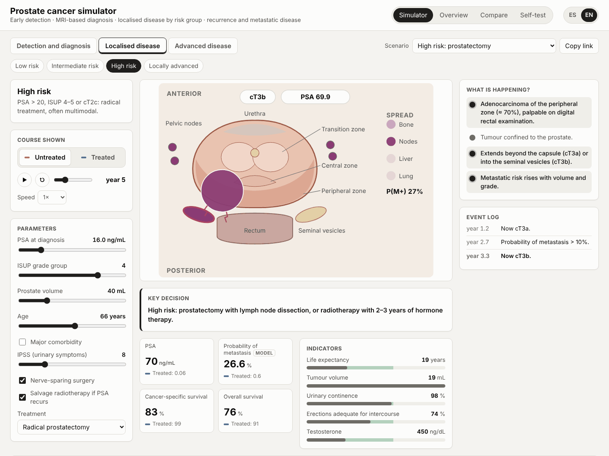

# Prostate cancer simulator

**Early detection · MRI-based diagnosis · localised disease by risk group · recurrence and metastatic disease**

An interactive teaching simulator of prostate cancer from the first PSA test to castration-resistant disease. Pick a scenario, change PSA, grade, gland size, age and comorbidity, choose a treatment, and watch the course over weeks, months or years on a live axial diagram of the prostate (zones, tumour, capsule, seminal vesicles, rectum, pelvic nodes and distant spread). The **untreated** (or reference) course is shown by default; the **treated** course is one click away for comparison.

**Live demo:** https://ferasmed-dev.github.io/prostate-cancer-simulator/ · English: https://ferasmed-dev.github.io/prostate-cancer-simulator/?lang=en



> Teaching tool · not for clinical use.

## What it shows

9 simulations in three blocks, with 38 ready-made scenarios:

| Block | Simulations | Compared courses |
|---|---|---|
| **Detection and diagnosis** | Early detection with PSA (age, family history, BRCA2, African ancestry, grade, testing interval) · diagnostic pathway (PSA density, rectal examination, PI-RADS, transperineal vs transrectal biopsy) | No screening vs PSA testing · systematic biopsy without MRI vs MRI first |
| **Localised disease** | EAU low, intermediate (favourable/unfavourable), high risk and locally advanced: active surveillance, watchful waiting, radical prostatectomy (nerve-sparing, lymph node dissection, salvage radiotherapy), external beam radiotherapy ± hormone therapy, brachytherapy, focal therapy, multimodal treatment, hormone therapy alone | Untreated vs treated |
| **Advanced disease** | Biochemical recurrence after prostatectomy (PSA doubling time, salvage radiotherapy) · metastatic hormone-sensitive (high/low volume; castration alone, + ARPI, + docetaxel, triplet) · castration-resistant (ARPI, docetaxel, olaparib, ¹⁷⁷Lu-PSMA-617, cabazitaxel by prior treatment and biomarkers) | Untreated (or castration only) vs treated |

For each simulation:

- **Diagram.** Peripheral, transition and central zones, anterior fibromuscular stroma and urethra; the tumour growing in the peripheral zone, capsule breach (cT3a), seminal vesicle (cT3b) and rectal invasion (cT4); positive pelvic nodes; the prostatectomy bed with the anastomosis and any residual disease; radiotherapy beams, brachytherapy seeds, focal-therapy zone, surveillance; MRI lesion by PI-RADS category with systematic and targeted cores and the biopsy route; PSA, stage and testosterone badges; a spread panel (bone, nodes, liver, lung).
- **Sliders and toggles** for every driver of the course, and a **key decision** panel that follows the EAU recommendation for the current patient.
- **"What is happening?"** lights up each step as it happens; an **event log** records stage changes, MRI and biopsy results, surgery and margins, reclassification on surveillance, biochemical recurrence (PSA > 0.2 after surgery, Phoenix after radiotherapy), castration, castration resistance and so on.
- **Indicators** (life expectancy, continence, erections, testosterone, PSA density, median survival), **charts** (small multiples with hover) or a **data table**, a **fact sheet** and **reference values**.
- Three more views: **Overview**, **Compare** (up to three simulations side by side) and **Self-test** (16 short cases, each linked to the scenario that explains it).
- Spanish by default, English with the switch (top right) or `?lang=en`; light and dark mode; works on phones.

## Curriculum fit

Prostate cancer is core content of the clinical module (*Módulo III, Formación clínica humana*, Orden ECI/332/2008) and of diagnostic and therapeutic procedures (*Módulo IV*) in every Spanish medical degree, and a recurrent MIR topic (risk groups, PSA and MRI pathway, active surveillance, hormone therapy and castration resistance). It is typically taught in **Urología** (often within *Patología médica y quirúrgica del aparato genitourinario*), with input from **Oncología médica**, **Oncología radioterápica**, **Anatomía patológica** and **Radiología**.

The simulator is topic-framed and faculty-neutral: students and teachers at any Spanish medical faculty can use it, whatever their course order or numbering.

## For teachers

Every scenario has a link you can project or share; the table below lists all of them with what the model produces. Links open on the untreated (reference) course; press the second course button to compare. Remove `&lang=en` for Spanish, and add `&autoplay=0` to start paused. Any custom set-up can be shared with the **Copy link** button.

## Presets: expected results

Values are the last time point of each run, reference → compared course (two charted variables). They are checked automatically in `tests/model.test.js`.

**Detection and diagnosis**

| Preset (deep link) | Simulation | End of run: reference → compared course | Key events (with treatment) |
|---|---|---|---|
| [Average risk at 55](https://ferasmed-dev.github.io/prostate-cancer-simulator/?preset=screeningAverage&lang=en) `screeningAverage` | Early detection with PSA (20 years) | Probability of metastasis 7.2 → 0.6 %; Cancer-specific survival 89.3 → 97.3 % | PSA ≥ 3 but MRI shows no significant lesion: PSA follow-up; PSA ≥ 3: MRI shows a suspicious lesion; targeted biopsy; Clinically significant cancer (cT2a): radical treatment |
| [Screening a grade 1 tumour](https://ferasmed-dev.github.io/prostate-cancer-simulator/?preset=screeningIndolent&lang=en) `screeningIndolent` | Early detection with PSA (20 years) | Probability of metastasis 0.1 → 0.1 %; Cancer-specific survival 99.8 → 99.8 % | PSA ≥ 3 but MRI shows no significant lesion: PSA follow-up |
| [BRCA2 carrier at 45](https://ferasmed-dev.github.io/prostate-cancer-simulator/?preset=screeningBrca2&lang=en) `screeningBrca2` | Early detection with PSA (20 years) | Probability of metastasis 21.1 → 0.9 %; Cancer-specific survival 57.8 → 95.3 % | PSA ≥ 3 but MRI shows no significant lesion: PSA follow-up; PSA ≥ 3: MRI shows a suspicious lesion; targeted biopsy; Clinically significant cancer (cT2a): radical treatment |
| [Aggressive tumour with PSA every 4 years](https://ferasmed-dev.github.io/prostate-cancer-simulator/?preset=screeningAggressive&lang=en) `screeningAggressive` | Early detection with PSA (20 years) | Probability of metastasis 40.1 → 1.3 %; Cancer-specific survival 27.5 → 92.4 % | PSA ≥ 3: MRI shows a suspicious lesion; targeted biopsy; Clinically significant cancer (cT2a): radical treatment |
| [PSA 7, PI-RADS 4](https://ferasmed-dev.github.io/prostate-cancer-simulator/?preset=pathwayPirads4&lang=en) `pathwayPirads4` | Diagnostic pathway: PSA, MRI and biopsy (12 weeks) | Probability of significant cancer 22.5 → 35.5 %; Significant cancer diagnosed 15.7 → 32.7 % | PSA confirmed on a second test; Multiparametric MRI: PI-RADS 4; Targeted biopsy of the lesion + systematic cores |
| [PSA 5.5 in a large gland, PI-RADS 2](https://ferasmed-dev.github.io/prostate-cancer-simulator/?preset=pathwayPirads2&lang=en) `pathwayPirads2` | Diagnostic pathway: PSA, MRI and biopsy (12 weeks) | Probability of significant cancer 16.1 → 1.9 %; Significant cancer diagnosed 11.3 → 0 % | PSA confirmed on a second test; Multiparametric MRI: PI-RADS 2; PI-RADS 1–2 with low PSA density: biopsy avoided, PSA follow-up |
| [PSA 12, suspicious DRE, PI-RADS 5](https://ferasmed-dev.github.io/prostate-cancer-simulator/?preset=pathwayPirads5Dre&lang=en) `pathwayPirads5Dre` | Diagnostic pathway: PSA, MRI and biopsy (12 weeks) | Probability of significant cancer 61.1 → 91.7 %; Significant cancer diagnosed 42.7 → 84.3 % | PSA confirmed on a second test; Multiparametric MRI: PI-RADS 5; Targeted biopsy of the lesion + systematic cores |
| [Transrectal biopsy](https://ferasmed-dev.github.io/prostate-cancer-simulator/?preset=pathwayTransrectal&lang=en) `pathwayTransrectal` | Diagnostic pathway: PSA, MRI and biopsy (12 weeks) | Probability of significant cancer 22.5 → 35.5 %; Significant cancer diagnosed 15.7 → 32.7 % | PSA confirmed on a second test; Multiparametric MRI: PI-RADS 4; Targeted biopsy of the lesion + systematic cores; Transrectal route: higher risk of infection and sepsis |

**Localised disease**

| Preset (deep link) | Simulation | End of run: reference → compared course | Key events (with treatment) |
|---|---|---|---|
| [Low risk: active surveillance](https://ferasmed-dev.github.io/prostate-cancer-simulator/?preset=lowRiskSurveillance&lang=en) `lowRiskSurveillance` | Low risk (20 years) | Probability of metastasis 1.3 → 0.1 %; Cancer-specific survival 97.1 → 99.3 % | Active surveillance; Now cT2b; Reclassification on surveillance (grade or volume progression): prostatectomy; At one year some stress incontinence persists |
| [Low risk: prostatectomy](https://ferasmed-dev.github.io/prostate-cancer-simulator/?preset=lowRiskProstatectomy&lang=en) `lowRiskProstatectomy` | Low risk (20 years) | Probability of metastasis 1.3 → 0 %; Cancer-specific survival 97.1 → 100 % | Radical prostatectomy. Risk of a positive margin ≈ 15%; At one year some stress incontinence persists |
| [Low risk: brachytherapy](https://ferasmed-dev.github.io/prostate-cancer-simulator/?preset=lowRiskBrachy&lang=en) `lowRiskBrachy` | Low risk (20 years) | Probability of metastasis 1.3 → 0 %; Cancer-specific survival 97.1 → 100 % | Permanent seed brachytherapy |
| [Low risk: focal therapy](https://ferasmed-dev.github.io/prostate-cancer-simulator/?preset=lowRiskFocal&lang=en) `lowRiskFocal` | Low risk (20 years) | Probability of metastasis 1.3 → 0.2 %; Cancer-specific survival 97.1 → 99.5 % | Focal therapy of the index lesion |
| [Low risk at 82 with comorbidity](https://ferasmed-dev.github.io/prostate-cancer-simulator/?preset=lowRiskElderlyObservation&lang=en) `lowRiskElderlyObservation` | Low risk (20 years) | Probability of metastasis 1.3 → 1.3 %; Cancer-specific survival 97.1 → 97.1 % | Watchful waiting: palliative treatment only if symptoms appear; Now cT2b |
| [Intermediate risk: prostatectomy](https://ferasmed-dev.github.io/prostate-cancer-simulator/?preset=intermediateProstatectomy&lang=en) `intermediateProstatectomy` | Intermediate risk (20 years) | Probability of metastasis 21.5 → 0.1 %; Cancer-specific survival 59.6 → 99.6 % | Radical prostatectomy. Risk of a positive margin ≈ 18%; At one year some stress incontinence persists; Biochemical recurrence: PSA > 0.2 ng/mL after prostatectomy; Early salvage radiotherapy to the prostate bed |
| [Intermediate risk: radiotherapy + hormone therapy](https://ferasmed-dev.github.io/prostate-cancer-simulator/?preset=intermediateRadiotherapy&lang=en) `intermediateRadiotherapy` | Intermediate risk (20 years) | Probability of metastasis 21.5 → 0.2 %; Cancer-specific survival 59.6 → 99.5 % | Radiotherapy with 6 months of hormone therapy; External beam radiotherapy |
| [Brachytherapy in a 70 mL gland](https://ferasmed-dev.github.io/prostate-cancer-simulator/?preset=intermediateBrachyLargeGland&lang=en) `intermediateBrachyLargeGland` | Intermediate risk (20 years) | Probability of metastasis 19.2 → 1.8 %; Cancer-specific survival 64.2 → 96.8 % | Brachytherapy outside its indication (gland ≥ 50 mL, IPSS ≥ 12 or ISUP > 2); Permanent seed brachytherapy; Large gland or high IPSS: risk of urinary retention after brachytherapy; Biochemical recurrence after radiotherapy (nadir + 2 ng/mL, Phoenix) |
| [Favourable intermediate on surveillance](https://ferasmed-dev.github.io/prostate-cancer-simulator/?preset=favourableIntermediateSurveillance&lang=en) `favourableIntermediateSurveillance` | Intermediate risk (20 years) | Probability of metastasis 14.4 → 0.7 %; Cancer-specific survival 73.8 → 96.1 % | Active surveillance; Now cT2b; Reclassification on surveillance (grade or volume progression): prostatectomy; At one year some stress incontinence persists |
| [High risk: prostatectomy](https://ferasmed-dev.github.io/prostate-cancer-simulator/?preset=highRiskProstatectomy&lang=en) `highRiskProstatectomy` | High risk (20 years) | Probability of metastasis 97.1 → 13 %; Cancer-specific survival 1.6 → 86.2 % | Radical prostatectomy. Risk of a positive margin ≈ 22%; Extended pelvic lymph node dissection; At one year some stress incontinence persists; Biochemical recurrence: PSA > 0.2 ng/mL after prostatectomy |
| [High risk: radiotherapy + long hormone therapy](https://ferasmed-dev.github.io/prostate-cancer-simulator/?preset=highRiskRadiotherapyAdt&lang=en) `highRiskRadiotherapyAdt` | High risk (20 years) | Probability of metastasis 97.1 → 8.9 %; Cancer-specific survival 1.6 → 89.8 % | Radiotherapy with 30 months of hormone therapy; External beam radiotherapy; Biochemical recurrence after radiotherapy (nadir + 2 ng/mL, Phoenix) |
| [High risk on surveillance (error)](https://ferasmed-dev.github.io/prostate-cancer-simulator/?preset=highRiskSurveillance&lang=en) `highRiskSurveillance` | High risk (20 years) | Probability of metastasis 97.1 → 20.4 %; Cancer-specific survival 1.6 → 67.5 % | Active surveillance; Surveillance of a high-risk tumour: not indicated; Now cT3a; Reclassification on surveillance (grade or volume progression): prostatectomy |
| [High risk without nerve sparing](https://ferasmed-dev.github.io/prostate-cancer-simulator/?preset=highRiskNoNerveSparing&lang=en) `highRiskNoNerveSparing` | High risk (20 years) | Probability of metastasis 97.1 → 13 %; Cancer-specific survival 1.6 → 86.2 % | Radical prostatectomy. Risk of a positive margin ≈ 22%; Extended pelvic lymph node dissection; At one year some stress incontinence persists; Biochemical recurrence: PSA > 0.2 ng/mL after prostatectomy |
| [Locally advanced: radiotherapy + hormone therapy](https://ferasmed-dev.github.io/prostate-cancer-simulator/?preset=locallyAdvancedEbrtAdt&lang=en) `locallyAdvancedEbrtAdt` | Locally advanced (20 years) | Probability of metastasis 98.7 → 35 %; Cancer-specific survival 0.6 → 60.5 % | Radiotherapy with 30 months of hormone therapy; External beam radiotherapy; Biochemical recurrence after radiotherapy (nadir + 2 ng/mL, Phoenix); Probability of metastasis > 10% |
| [Locally advanced: multimodal surgery](https://ferasmed-dev.github.io/prostate-cancer-simulator/?preset=locallyAdvancedMultimodal&lang=en) `locallyAdvancedMultimodal` | Locally advanced (20 years) | Probability of metastasis 98.7 → 5.5 %; Cancer-specific survival 0.6 → 84.8 % | Radical prostatectomy. Risk of a positive margin ≈ 50%; Extended pelvic lymph node dissection; Surgery with hormone therapy and adjuvant radiotherapy as the pathology requires; At one year some stress incontinence persists |
| [Locally advanced: hormone therapy alone](https://ferasmed-dev.github.io/prostate-cancer-simulator/?preset=locallyAdvancedAdtAlone&lang=en) `locallyAdvancedAdtAlone` | Locally advanced (20 years) | Probability of metastasis 98.7 → 94.2 %; Cancer-specific survival 0.6 → 22.8 % | Hormone therapy alone, without local treatment; Probability of metastasis > 10%; After ≈ 2 years of castration the tumour stops responding |

**Advanced disease**

| Preset (deep link) | Simulation | End of run: reference → compared course | Key events (with treatment) |
|---|---|---|---|
| [Recurrence at PSA 0.3: early salvage](https://ferasmed-dev.github.io/prostate-cancer-simulator/?preset=bcrEarlySalvage&lang=en) `bcrEarlySalvage` | Biochemical recurrence after prostatectomy (10 years) | Probability of metastasis 73.7 → 3.5 %; Cancer-specific survival 54.3 → 99.3 % | Salvage radiotherapy at PSA 0.35 ng/mL; PSA > 2 ng/mL |
| [Late salvage at PSA 1.5](https://ferasmed-dev.github.io/prostate-cancer-simulator/?preset=bcrLateSalvage&lang=en) `bcrLateSalvage` | Biochemical recurrence after prostatectomy (10 years) | Probability of metastasis 86.1 → 30.1 %; Cancer-specific survival 34.3 → 94 % | Salvage radiotherapy at PSA 1.77 ng/mL; PSA > 2 ng/mL; Probability of metastasis > 10% |
| [PSA doubling in 4 months](https://ferasmed-dev.github.io/prostate-cancer-simulator/?preset=bcrFastDoubling&lang=en) `bcrFastDoubling` | Biochemical recurrence after prostatectomy (10 years) | Probability of metastasis 99.9 → 99 %; Cancer-specific survival 13.6 → 54.7 % | Salvage radiotherapy at PSA 0.45 ng/mL; PSA > 2 ng/mL; Probability of metastasis > 10% |
| [Early hormone therapy instead of salvage](https://ferasmed-dev.github.io/prostate-cancer-simulator/?preset=bcrEarlyAdt&lang=en) `bcrEarlyAdt` | Biochemical recurrence after prostatectomy (10 years) | Probability of metastasis 73.7 → 2.2 %; Cancer-specific survival 54.3 → 99.5 % | Early hormone therapy, without radiotherapy; The tumour becomes castration-resistant; PSA > 2 ng/mL |
| [High volume: castration + ARPI](https://ferasmed-dev.github.io/prostate-cancer-simulator/?preset=mhspcHighVolumeArpi&lang=en) `mhspcHighVolumeArpi` | Metastatic hormone-sensitive (72 months) | PSA 3600 → 2533 ng/mL; Overall survival 1.4 → 29.8 % | Castration starts; An ARPI is added; Testosterone < 50 ng/dL; Progression on castration: castration-resistant prostate cancer |
| [High volume: castration alone](https://ferasmed-dev.github.io/prostate-cancer-simulator/?preset=mhspcAdtAlone&lang=en) `mhspcAdtAlone` | Metastatic hormone-sensitive (72 months) | PSA 3600 → 3600 ng/mL; Overall survival 1.4 → 15.6 % | Castration starts; Testosterone < 50 ng/dL; Progression on castration: castration-resistant prostate cancer |
| [High volume: triplet](https://ferasmed-dev.github.io/prostate-cancer-simulator/?preset=mhspcTriplet&lang=en) `mhspcTriplet` | Metastatic hormone-sensitive (72 months) | PSA 3600 → 129 ng/mL; Overall survival 1.4 → 44.9 % | Castration starts; Triplet: castration + docetaxel + ARPI; Testosterone < 50 ng/dL; Progression on castration: castration-resistant prostate cancer |
| [Low volume with docetaxel](https://ferasmed-dev.github.io/prostate-cancer-simulator/?preset=mhspcLowVolumeDocetaxel&lang=en) `mhspcLowVolumeDocetaxel` | Metastatic hormone-sensitive (72 months) | PSA 1200 → 221 ng/mL; Overall survival 11.3 → 43.4 % | Castration starts; Six cycles of docetaxel are added; Docetaxel in low volume: no proven survival benefit; Testosterone < 50 ng/dL |
| [Castration-resistant, ARPI-naive](https://ferasmed-dev.github.io/prostate-cancer-simulator/?preset=mcrpcArpiNaive&lang=en) `mcrpcArpiNaive` | Castration-resistant (48 months) | PSA 1200 → 1200 ng/mL; Overall survival 5.9 → 13.8 % | PSA response ≥ 50% |
| [Switching ARPI after an ARPI](https://ferasmed-dev.github.io/prostate-cancer-simulator/?preset=mcrpcArpiAfterArpi&lang=en) `mcrpcArpiAfterArpi` | Castration-resistant (48 months) | PSA 1200 → 1200 ng/mL; Overall survival 5.9 → 6.8 % | ARPI after another ARPI: cross-resistance, little effect |
| [BRCA mutation: olaparib](https://ferasmed-dev.github.io/prostate-cancer-simulator/?preset=mcrpcOlaparibBrca&lang=en) `mcrpcOlaparibBrca` | Castration-resistant (48 months) | PSA 1200 → 1200 ng/mL; Overall survival 5.9 → 14.2 % | PSA response ≥ 50% |
| [Olaparib without a mutation](https://ferasmed-dev.github.io/prostate-cancer-simulator/?preset=mcrpcOlaparibNoMutation&lang=en) `mcrpcOlaparibNoMutation` | Castration-resistant (48 months) | PSA 1200 → 1200 ng/mL; Overall survival 5.9 → 5.9 % | Olaparib without a DNA repair mutation: no benefit |
| [¹⁷⁷Lu-PSMA after ARPI and docetaxel](https://ferasmed-dev.github.io/prostate-cancer-simulator/?preset=mcrpcLuPsma&lang=en) `mcrpcLuPsma` | Castration-resistant (48 months) | PSA 1200 → 1200 ng/mL; Overall survival 5.9 → 17.3 % | PSA response ≥ 50% |
| [Docetaxel after an ARPI](https://ferasmed-dev.github.io/prostate-cancer-simulator/?preset=mcrpcDocetaxel&lang=en) `mcrpcDocetaxel` | Castration-resistant (48 months) | PSA 1200 → 1200 ng/mL; Overall survival 5.9 → 11.6 % | PSA response ≥ 50% |

## How the model works

All runs are deterministic (expected values, not random patients). Each simulation is a small time-stepped model in `src/model/prostate.js`.

**Tumour growth and PSA (localised disease, early detection).** Tumour volume *V* (mL) grows logistically with a doubling time set by the ISUP grade group, towards a 40 mL ceiling:

```
dV/dt = k · V · (1 − V/40),   k = ln2 / TD(ISUP)
PSA = 0.066 · prostate volume + V · c(ISUP)        c = 3.5 ng/mL per mL (2.5 in ISUP 5)
cT  = T1c < 0.5 mL ≤ T2a < 1.5 ≤ T2b < 3 ≤ T2c < 6 ≤ T3a < 12 ≤ T3b < 25 ≤ T4     (Model)
```

**Metastasis and death.** The probability of distant spread grows with tumour volume and grade, and death from cancer follows metastasis; other-cause death follows a Gompertz curve by age (×2.5 with major comorbidity), which also gives the life-expectancy gauge (≈ 19 years at 65):

```
dP(M)/dt = MET_K(ISUP) · V · (1 − P(M))
h(cancer death) = P(M) · (0.35/year untreated, 0.15/year on hormone therapy)
h(other cause)  = exp(−10.6 + 0.095 · age) · (2.5 if comorbid)
```

**Treatments.** Prostatectomy removes the gland and leaves residual disease proportional to the margin risk (by stage); PSA > 0.2 ng/mL triggers salvage radiotherapy. Radiotherapy and brachytherapy kill tumour over 18 months with local control by risk group; hormone therapy is added for 6 months (unfavourable intermediate) or 30 months (high risk, locally advanced). Castration lowers testosterone to < 50 ng/dL, PSA by ≈ 97 % and makes the tumour regress, until resistance after ≈ 2 years. Functional outcomes: continence falls to 40 % after surgery and recovers to ≈ 90 % over a year; erections recover to 60 % of baseline with nerve-sparing and 25 % without; radiotherapy and brachytherapy affect erections later; hormone therapy suppresses them.

**Diagnostic pathway.** Pre-test probability of clinically significant cancer: `logit(p) = −2.2 + 5.5·PSAD + 1·DRE + 0.03·(age − 63) + 0.4·family` (Model); MRI multiplies the odds by the PI-RADS likelihood ratio; detection = probability × biopsy sensitivity (systematic 0.70, MRI-targeted 0.92).

**Metastatic disease.** Survival uses a Weibull hazard with the median of the reference arm and the hazard ratio of each trial; PSA follows a tumour burden that regresses on treatment and regrows at castration resistance.

### Main parameters and their basis

| Parameter | Value | Basis |
|---|---|---|
| Doubling time by ISUP 1–5 | 5 · 3.5 · 2.5 · 1.6 · 1 years | Tuning (Model), ordered by grade as in natural-history series |
| Metastatic rate MET_K by ISUP 1–5 | 0.00015 · 0.0008 · 0.0022 · 0.006 · 0.012 per mL per year | Tuning (Model) so untreated low risk keeps > 95 % cancer-specific survival at 20 years and high risk falls below 10 % |
| PSA per mL of cancer / of benign gland | 3.5 / 0.066 ng/mL | Stamey et al.; Model simplification |
| EAU risk groups | low PSA < 10, ISUP 1, cT1–2a · intermediate PSA 10–20, ISUP 2–3 or cT2b · high PSA > 20, ISUP 4–5 or cT2c · locally advanced cT3–4 or cN1 | EAU guideline |
| Positive margin risk by stage | 12–22 % (T1–T2) · 35 % (T3a) · 50 % (T3b) | Prostatectomy series (Model) |
| Hormone therapy with radiotherapy | 4–6 months (intermediate) · 2–3 years (high, locally advanced) | EAU guideline |
| Biochemical recurrence | PSA > 0.2 ng/mL after surgery; nadir + 2 ng/mL after radiotherapy (Phoenix) | EAU guideline |
| Salvage radiotherapy control | 70 % (PSA < 0.5) · 55 % (0.5–1) · 40 % (> 1), × 0.8 if doubling time < 6 months | Stephenson nomogram, trend (Model) |
| Family history relative risk | ×1.8 (father or brother) · ×5.5 (father and brother) · ×7.7 (two brothers); BRCA2 ×8.6 | As taught; BRCA2 from IMPACT/PROFILE literature (approximate) |
| PI-RADS likelihood ratios 1–5 | 0.05 · 0.1 · 0.4 · 1.9 · 7 | Tuning (Model) to MRI-pathway series (PRECISION, MRI-FIRST) |
| Biopsy infection | transrectal 3 % · transperineal 0.5 % | Literature range |
| mHSPC median OS with castration alone | 34 months high volume · 63 low volume | CHAARTED |
| mHSPC hazard ratios vs castration | ARPI 0.65 · docetaxel 0.63 (high volume) / 1.0 (low) · triplet 0.43 (high) / 0.6 (low) | LATITUDE, TITAN, ARCHES, STAMPEDE; CHAARTED; ARASENS, PEACE-1 (combined, Model) |
| Time to castration resistance | 20 months castration alone · 30 docetaxel · 45 ARPI · 55 triplet | Range as taught (18–24 months) and trial time-to-CRPC (Model) |
| mCRPC hazard ratios | docetaxel 0.76 · ARPI 0.7 (0.95 after another ARPI) · olaparib 0.69 (only with HRR mutation) · ¹⁷⁷Lu-PSMA 0.62 · cabazitaxel 0.7 | TAX327, COU-AA-302/PREVAIL, PROfound, VISION, TROPIC/CARD |

Values tagged **Model** in the app are tuning choices or proxies.

### Known simplifications

- One index tumour per patient; multifocality and anterior tumours are not drawn. The volume → cT mapping is a proxy, not a clinical rule.
- Grade is fixed during a run; on surveillance, "reclassification" is triggered by volume doubling or cT2c, not by a re-biopsy grade upgrade.
- Survival curves are expected values for a cohort; individual variation is not simulated.
- Toxicity is limited to continence, erections, retention risk and infection; rectal toxicity, strictures and hormone-therapy metabolic effects are described in the fact sheets, not modelled.
- In metastatic disease, treatment effects come from trial hazard ratios applied to one median; trials did not always use the same comparator.
- The castration-resistant simulation models one line of treatment at a time.

## Layout

```
index.html
src/model.js              public API: entities, presets, key decisions, model tags
src/model/core.js         shared engine (run, runBoth, sanitize…)
src/model/onco.js         shared oncology helpers (age hazard, Weibull)
src/model/prostate.js     all prostate simulations
src/i18n.js               Spanish + English strings, self-test questions
src/ui.js                 DOM, playback, views, deep links, window.__sim hook
src/schematic.js          SVG prostate diagram
src/charts.js             dependency-free SVG charts
src/styles.css
tests/model.test.js       risk groups, mechanisms and every preset
tests/i18n.test.js        every string the model can emit exists in both languages
curriculum.json
```

## Run locally

No build step and no dependencies.

```bash
python3 -m http.server 8000
# open http://localhost:8000
```

## Tests

```bash
npm test     # node --test (Node 18+)
```

The tests check every simulation in both arms (finite, bounded values; extremes of every slider; purity), EAU risk-group boundaries, PSA and staging, grade vs growth and metastasis, life expectancy, MRI likelihood ratios, functional outcomes of surgery and nerve sparing, the survival benefit of treatment in intermediate, high and locally advanced disease, every preset's expected behaviour and the completeness of both languages. GitHub Actions runs them on every push.

## Deploy (GitHub Pages)

1. Create an empty public repository named `prostate-cancer-simulator`.
2. Push these files to `main` (with `index.html` at the root).
3. Settings → Pages → Deploy from a branch → `main` / `(root)`.
4. After 1–2 minutes the site is live at https://ferasmed-dev.github.io/prostate-cancer-simulator/.

## References

- EAU – EANM – ESTRO – ESUR – ISUP – SIOG Guidelines on Prostate Cancer. European Association of Urology, current edition.
- Council of the European Union. Council Recommendation on strengthening prevention through early detection: a new EU approach on cancer screening. 2022.
- Epstein JI, et al. The 2014 ISUP consensus conference on Gleason grading of prostatic carcinoma. Am J Surg Pathol. 2016;40:244–52.
- Turkbey B, et al. PI-RADS version 2.1. Eur Urol. 2019;76:340–51.
- Kasivisvanathan V, et al. MRI-targeted or standard biopsy for prostate-cancer diagnosis (PRECISION). N Engl J Med. 2018;378:1767–77.
- Hamdy FC, et al. Fifteen-year outcomes after monitoring, surgery, or radiotherapy for prostate cancer (ProtecT). N Engl J Med. 2023;388:1547–58.
- Bill-Axelson A, et al. Radical prostatectomy or watchful waiting in prostate cancer — 29-year follow-up (SPCG-4). N Engl J Med. 2018;379:2319–29.
- Hugosson J, et al. A 16-yr follow-up of the European Randomized study of Screening for Prostate Cancer. Eur Urol. 2019;76:43–51.
- Roach M, et al. Defining biochemical failure following radiotherapy (Phoenix definition). Int J Radiat Oncol Biol Phys. 2006;65:965–74.
- Vale CL, et al. Adjuvant or early salvage radiotherapy after radical prostatectomy (ARTISTIC meta-analysis). Lancet. 2020;396:1422–31.
- Stamey TA, et al. Prostate-specific antigen as a serum marker for adenocarcinoma of the prostate. N Engl J Med. 1987;317:909–16.
- Sweeney CJ, et al. Chemohormonal therapy in metastatic hormone-sensitive prostate cancer (CHAARTED). N Engl J Med. 2015;373:737–46; Kyriakopoulos CE, et al. J Clin Oncol. 2018;36:1080–7.
- Fizazi K, et al. Abiraterone plus prednisone in metastatic, castration-sensitive prostate cancer (LATITUDE). N Engl J Med. 2017;377:352–60; Chi KN, et al. Apalutamide (TITAN). N Engl J Med. 2019;381:13–24; Armstrong AJ, et al. Enzalutamide (ARCHES). J Clin Oncol. 2019;37:2974–86.
- Smith MR, et al. Darolutamide and survival in metastatic, hormone-sensitive prostate cancer (ARASENS). N Engl J Med. 2022;386:1132–42; Fizazi K, et al. PEACE-1. Lancet. 2022;399:1695–707.
- Tannock IF, et al. Docetaxel plus prednisone or mitoxantrone (TAX327). N Engl J Med. 2004;351:1502–12; de Bono JS, et al. Cabazitaxel (TROPIC). Lancet. 2010;376:1147–54; de Wit R, et al. Cabazitaxel versus abiraterone or enzalutamide (CARD). N Engl J Med. 2019;381:2506–18.
- Ryan CJ, et al. Abiraterone in chemotherapy-naive mCRPC (COU-AA-302). Lancet Oncol. 2015;16:152–60; Beer TM, et al. Enzalutamide (PREVAIL). N Engl J Med. 2014;371:424–33.
- de Bono J, et al. Olaparib for metastatic castration-resistant prostate cancer (PROfound). N Engl J Med. 2020;382:2091–102; Hussain M, et al. N Engl J Med. 2020;383:2345–57.
- Sartor O, et al. Lutetium-177–PSMA-617 for metastatic castration-resistant prostate cancer (VISION). N Engl J Med. 2021;385:1091–103.

## Licence

MIT © 2026 Feras Elhissi. See [LICENSE](LICENSE).
